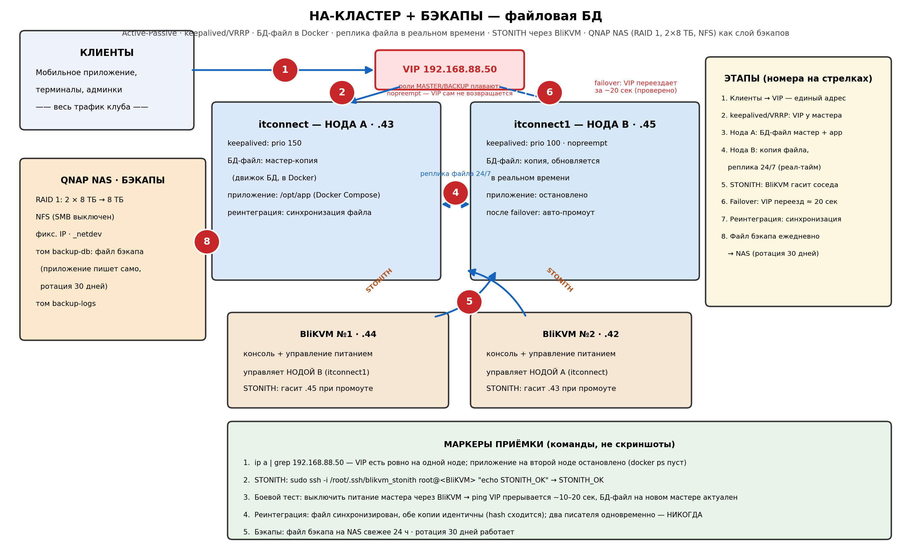

# HA Bundle v4 — Active/Passive кластер на keepalived + PostgreSQL 16

Пара Ubuntu-серверов с единым виртуальным IP (VIP), PostgreSQL-репликацией и
аппаратным STONITH через BliKVM. Боевой failover ≈ 20 секунд, без split-brain.



## 1. Состав и адреса

| Устройство            | IP              | Роль |
|-----------------------|-----------------|------|
| itconnect (mobile)    | 192.168.88.43   | нода A: keepalived prio 150, PostgreSQL PRIMARY/REPLICA, слот приложения `/opt/app` |
| itconnect1 (mobile1)  | 192.168.88.45   | нода B: keepalived prio 100 (nopreempt), PostgreSQL REPLICA/PRIMARY, слот приложения |
| **VIP**               | **192.168.88.50** | единый адрес сервиса (живёт на текущем мастере; роли плавают после failover) |
| BliKVM №1             | 192.168.88.44   | KVM-консоль + питание **ноды B** (itconnect1) |
| BliKVM №2             | 192.168.88.42   | KVM-консоль + питание **ноды A** (itconnect) |
| QNAP NAS (опционально)| по сети         | слой бэкапов: NFS `/mnt/backup-db`, см. раздел 8 |

STONITH перекрёстный: каждая нода через свой BliKVM физически выключает соседа
при получении роли мастера. Питание и консоль управляются по сети независимо от
состояния самой ноды — это последняя линия защиты от split-brain.

## 2. Репозиторий → серверы (какой файл куда)

| Файл репозитория         | Путь на сервере | Куда ставить |
|--------------------------|-----------------|--------------|
| `keepalived.conf.master` | `/etc/keepalived/keepalived.conf` | только .43 |
| `keepalived.conf.backup` | `/etc/keepalived/keepalived.conf` | только .45 |
| `ha.env.itconnect`       | `/etc/ha/ha.env` | только .43 |
| `ha.env.itconnect1`      | `/etc/ha/ha.env` | только .45 |
| `ha-check.sh`            | `/etc/ha/ha-check.sh` | обе, `chmod +x` |
| `ha-link.sh`             | `/etc/ha/ha-link.sh`  | обе, `chmod +x` |
| `become-master.sh`       | `/etc/ha/become-master.sh` | обе, `chmod +x` |
| `become-backup.sh`       | `/etc/ha/become-backup.sh` | обе, `chmod +x` |
| `reintegrate.sh`         | `/etc/ha/reintegrate.sh`   | обе, `chmod +x` |
| `backup-nas.sh`          | `/etc/ha/backup-nas.sh` + cron | обе (раздел 8) |

⚠️ **Файлы на серверы — только через `scp`/ssh-перенаправление. Вставка
многострочного текста через веб-консоль BliKVM ("Paste text") теряет символы
и строки** — так уже получены битые конфиги. Для локальной консоли включите
поддержку мыши, длинные вставки разбивайте на короткие куски.

## 3. Архитектура (как это работает)

1. Клиенты ходят только на VIP `192.168.88.50`.
2. keepalived (VRRP, **unicast**) держит VIP на мастере. Обе ноды в состоянии
   BACKUP + `nopreempt`: VIP не отбирается у живого мастера более приоритетной
   нодой. Трекинг двойной:
   - `chk_pg` — локальный PostgreSQL отвечает (`pg_isready`);
   - `chk_link` — карта `eno1` поднята И шлюз пингуется (изолированная нода
     VIP не берёт).
3. PostgreSQL 16: streaming-репликация always-on через слот `ha_slot`.
   primary ровно один (проверка ниже).
4. `notify_master` → `become-master.sh`: STONITH соседа через BliKVM +
   подъём приложения из `/opt/app` (docker compose).
5. `notify_backup` → `become-backup.sh`: остановка приложения.

## 4. Ежедневная проверка (2 минуты, с любой ноды)

```bash
ip a | grep 192.168.88.50                                # VIP есть ровно на одной ноде
sudo -u postgres psql -tAc "select pg_is_in_recovery()"  # мастер: f | реплика: t
sudo -u postgres psql -tAc "select count(*) from pg_stat_replication"  # мастер: 1
ssh -i /root/.ssh/blikvm_stonith root@192.168.88.44 "echo STONITH_OK"    # STONITH .44
ssh -i /root/.ssh/blikvm_stonith root@192.168.88.42 "echo STONITH_OK"    # STONITH .42
ls -la /root/.ssh/ | grep -cE 'id_ed25519|id_rsa'        # ожидается >= 2 (ключи BliKVM)
docker ps --format '{{.Names}}\t{{.Status}}'            # контейнеры — на ноде с VIP
```

## 5. Failover

Происходит автоматически, когда текущий мастер перестаёт слать VRRP-анонсы
(падение ноды, postgres, линка). Резерв берёт VIP за ~3–6 секунд, шлёт STONITH,
поднимает приложение. **Боевой тест (только в окне обслуживания):**

```bash
# с любой ноды: через BliKVM отключить питание ТЕКУЩЕГО мастера
ssh -i /root/.ssh/blikvm_stonith root@$( [ "$(hostname)" = "mobile" ] && echo 192.168.88.42 || echo 192.168.88.44 ) "poweroff"
ping 192.168.88.50     # пауза ~10–20 сек, затем ответы
# данные на новом мастере целы; старый мастер потом вернуть через reintegrate.sh
```

## 6. Реинтеграция (вернуть ноду в строй)

На отремонтированной ноде (она станет репликой текущего мастера):

```bash
sudo bash /etc/ha/reintegrate.sh
```

Скрипт останавливает postgres, при необходимости создаёт слот `ha_slot` на
мастере, **пересоздаёт данные с нуля через `pg_basebackup`** (локальные данные
ноды уничтожаются!), прописывает `primary_conninfo` со слотом и стартует
реплику. Маркеры успеха: `t` и строка `Готово`.

Почему не `pg_rewind`: кластер собран без data-checksums и раньше — без
`wal_log_hints`, а rewind требует их **до** расхождения. Копия при объёме БД
в десятки МБ занимает секунды, поэтому basebackup — надёжнее.

## 7. Первичное развёртывание (если ноды чистые)

1. Установить Ubuntu Server, сеть eno1, hostname mobile / mobile1, пароль nfc.
2. На ОБЕИХ нодах, строго по очереди:

```bash
mkdir -p /etc/ha
# файлы из раздела 2 (каждый: chmod +x для *.sh)
# PostgreSQL 16: установить, настроить по вспомогательным файлам
#   pg_hba.conf: host replication replicator <peer>/32 scram-sha-256
#                host postgres     replicator <peer>/32 scram-sha-256  (для reintegrate/rewind)
#                host all          nfc        192.168.88.0/24 scram-sha-256
# postgresql.conf/auto.conf: listen_addresses='localhost,<свой IP>'  (только с РЕСТАРТОМ)
#                            wal_log_hints=on                        (только с РЕСТАРТОМ)
#   роль: CREATE ROLE replicator LOGIN REPLICATION PASSWORD '***';
#   пароль одинаковый на обеих нодах (= PG_REPL_PASS в ha.env)
# слот на будущем мастере: SELECT pg_create_physical_replication_slot('ha_slot');
# реплику на второй ноде поднять через reintegrate.sh
# ssh-ключи: ssh-keygen; ssh-copy-id root@<BliKVM своего соседа> (см. deploy.md)
sudo systemctl restart keepalived   # на каждой ноде после раскладки её конфига
```

3. Применить unicast-переход на работающей паре — **только синхронно** (одной
   командой, peer первым), иначе ноды перестанут слышать друг друга:

```bash
ssh nfc@<peer> "echo nfc | sudo -S systemctl reload keepalived" && echo nfc | sudo -S systemctl reload keepalived
```

## 8. Бэкапы на NAS (QNAP)

Поверх HA-кластера — файл-сервер с RAID 1 (2×8 ТБ), NFS (SMB выключен),
фиксированный IP, монтирование `_netdev`:

```bash
# /etc/fstab на обеих нодах:
# <nas-ip>:/backup-db  /mnt/backup-db  nfs  defaults,_netdev  0 0
sudo mkdir -p /mnt/backup-db && sudo mount -a
```

Cron (на обеих; скрипт сам делает дамп только на primary):

```bash
echo '30 3 * * * root /etc/ha/backup-nas.sh >> /var/log/backup-nas.log 2>&1' | sudo tee /etc/cron.d/backup-nas
```

Правило: NAS — второй экземпляр данных, но в одном офисе; для катастрофической
защиты периодически копировать дамп наружу (облако).

## 9. Известные грабли (проверено ночью инцидента)

1. `ha-check.sh` не должен проверять `pg_is_in_recovery()` — реплика в вечном
   FAULT и failover не случается никогда (баг v3, исправлено в v4).
2. `listen_addresses`/`wal_log_hints` применяются **только рестартом**
   postgres. Параметр прописан, но не применён = обратная репликация молча
   не работает.
3. `pg_basebackup -R` не сохраняет пароль в `primary_conninfo` — реплика не
   коннектится; reintegrate.sh дописывает.
4. Слот `ha_slot` живёт на текущем primary; после смены мастера его надо
   пересоздавать (reintegrate.sh делает сам).
5. BliKVM "Paste text" портит многострочные вставки — конфиги только scp/ssh.
6. Unicast-VRRP: обе ноды должны перейти синхронно, иначе элекция сорвётся.
7. `keepalived.conf`: обе ноды `state BACKUP`, иначе `nopreempt` не работает.
8. Приоритеты в файлах не перепутать: `.43`=150 (master-файл), `.45`=100.

## 10. Changelog
- **v5.1 (2026-11-20)**: добавлен раздел 11 «Хроника инцидентов и лечение» 
  (9 разборов: FAULT v3, рассинхрон VRRP, WOL-STONITH, pg_rewind, 
  listen_addresses/wal_log_hints без рестарта, пароль в primary_conninfo, слот 
  ha_slot, «чужой» listen_addresses после basebackup, WOL/BIOS-процедуры).
- **v4 (2026-11-19)**: unicast VRRP вместо multicast; новый `chk_link`
  (`ha-link.sh`); `ha-check.sh` без проверки роли (фикс вечного FAULT);
  `reintegrate.sh` переведён на `pg_basebackup`; добавлен `backup-nas.sh`;
  требование `wal_log_hints=on` и LAN в `listen_addresses`; pg_hba дополнен
  строками `host postgres replicator <peer>/32`; README переписан.
- **v3**: текущая боевое ядро (keepalived+STONITH+PG-репликация), баг с
  `pg_is_in_recovery` в `ha-check.sh` исправлен только в репозитории, не на
  серверах.
- **v2**: добавлен STONITH через BliKVM.
- **v1**: keepalived + ручной failover.
